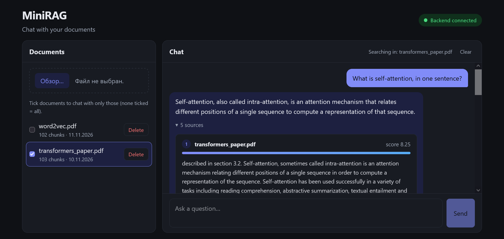

# MiniRAG

MiniRAG is a small Retrieval-Augmented Generation (RAG) application for chatting with your own documents. Upload PDF, TXT or Markdown files, ask questions in natural language, and get a short answer together with the passages it was based on.

It runs locally with Docker Compose: nothing is deployed anywhere, so you can clone the repository and try it on your own machine.

## Purpose

The project is a compact, end-to-end example of a RAG system, built to make each design choice visible rather than to be production-ready:

**document → chunks → embeddings → pgvector → re-ranker → LLM → answer**

1. An uploaded document is split into overlapping chunks (500 characters, 100 overlap by default) and cleaned of citation noise.
2. Each chunk is embedded with `sentence-transformers/all-MiniLM-L6-v2` and stored in PostgreSQL with the pgvector extension. Identical files are detected by hash and not ingested twice.
3. A question is embedded and the 30 closest chunks are fetched (cosine distance, HNSW index), optionally restricted to the documents you select.
4. A cross-encoder (`cross-encoder/ms-marco-MiniLM-L-6-v2`) re-ranks them and keeps the 5 best. Chunks it scores as irrelevant are dropped; if none remain, no LLM call is made.
5. Claude (`claude-haiku-5-5`) answers from those chunks only. The most relevant chunk is placed closest to the question in the prompt.

The embedding and re-ranking models run on CPU inside the API container, so no GPU is needed.

| Part | Technology |
|---|---|
| Backend | Python 3.12, FastAPI, psycopg, sentence-transformers |
| Storage | PostgreSQL 16 with pgvector |
| LLM | Anthropic API (Claude Haiku) |
| Frontend | React, TypeScript, Vite, served by nginx |

The UI has two panels: your documents on the left (upload, delete, tick the ones to search) and the chat on the right. Each answer has a collapsible list of its source chunks with relevance scores.



## Quick start

You need [Docker](https://docs.docker.com/get-docker/) with Compose and an [Anthropic API key](https://console.anthropic.com/) (used only to generate answers).

```bash
git clone https://github.com/spolivin/mini-rag.git
cd mini-rag

cp .env.example .env
# edit .env and set ANTHROPIC_API_KEY

docker compose up -d --build
```

Then open <http://localhost:8080>.

- The first build downloads PyTorch and the dependencies (the API image is about 2.4 GB).
- The first start also downloads the two models (about 130 MB) into a Docker volume and takes about a minute. Later starts reuse them. The `web` service waits until the API reports healthy.
- Without `ANTHROPIC_API_KEY`, uploading, listing and searching still work, but asking a question returns an error.
- `HF_TOKEN` in `.env` is optional. The models are public; the token only makes the Hugging Face downloads authenticated.

```bash
docker compose stop         # stop, keeping your documents
docker compose down         # remove containers, keeping your documents
docker compose down -v      # also delete the database and the model cache
```

Ports are bound to `127.0.0.1` (web 8080, API 8000, Postgres 5432) and can be changed in `.env`. The API's interactive docs are at <http://localhost:8000/docs>.

## Using it

1. Upload a `.pdf`, `.txt` or `.md` file. The request returns once the document is fully indexed.
2. Optionally tick the documents to search. With none ticked, all documents are searched.
3. Ask a question. Enter sends, Shift+Enter adds a new line.

Sample questions for a paper such as "Attention Is All You Need": *How many layers do the encoder and decoder have?*, *Why are the dot products scaled by √d_k?*

## Development setup

For working on the code, run only the database in Docker and the rest on the host. This needs [uv](https://docs.astral.sh/uv/), Python 3.12 and Node.js.

```bash
cp .env.example .env
docker compose up -d db

# Backend (http://127.0.0.1:8000)
cd backend
uv sync --extra dev
export ANTHROPIC_API_KEY=...
uv run fastapi dev

# Frontend, in a second terminal (http://127.0.0.1:5173, /api is proxied to the backend)
cd frontend
npm install
npm run dev -- --host 127.0.0.1
```

Tests run from `backend/` with `uv run pytest`. They use fake models, so nothing is downloaded and the Anthropic API is not called. The tests that touch documents need the database (`docker compose up -d db`) and skip themselves when it is unreachable.

### Layout

```
backend/
  app/    FastAPI service: routers, schemas, dependencies
  rag/    the RAG library (config, pipeline, stages), with no HTTP code
  tests/
frontend/ React app and the nginx config
db/       Postgres schema (init.sql)
docker-compose.yml
```

API endpoints: `GET /health`, `POST /documents`, `GET /documents`, `DELETE /documents/{doc_id}`, `POST /query`.

## Limitations

- **No authentication.** Anyone who can reach the app can upload, delete and query documents, and every question uses your Anthropic key. Keep it on localhost. Do not expose it to the internet without adding authentication, HTTPS, rate limiting and a spend limit on the key.
- **Your text is sent to Anthropic.** The retrieved chunks and your question go to the Claude API to produce the answer. Do not upload documents you are not allowed to share with it.
- **One question at a time.** The chat has no memory: each question is answered on its own, so follow-ups like "and the second one?" will not work. History is kept in the browser only and lost on reload.
- **Short answers.** The system prompt asks for 4-5 sentences with no introductions.
- **PDF extraction is plain text.** There is no OCR, so scanned PDFs yield nothing. Tables, equations and multi-column layouts can come out garbled, which hurts retrieval and answers.
- **No page numbers** in the sources, only the file name and score.
- **Fixed retrieval settings.** Chunk size, overlap, number of chunks and the models are defaults in `backend/rag/config/`, not controls in the UI. The embedder is English-oriented, and changing it to a different dimension requires changing `db/init.sql`.
- **Strict relevance cutoff.** Chunks the re-ranker scores at or below zero are discarded, so an unusual phrasing can produce "No relevant passages were found" even when the answer is in the document. Rephrasing the question usually helps.
- **Document identity is its file name.** Two different files with the same name and chunk settings conflict (HTTP 409). Uploads are capped at 50 MB by nginx only.
- **Local resources.** Expect roughly 0.6 GB of RAM for the API at idle, more while ingesting large documents, and noticeable CPU use during ingestion and re-ranking.

## License

[MIT](./LICENSE)
